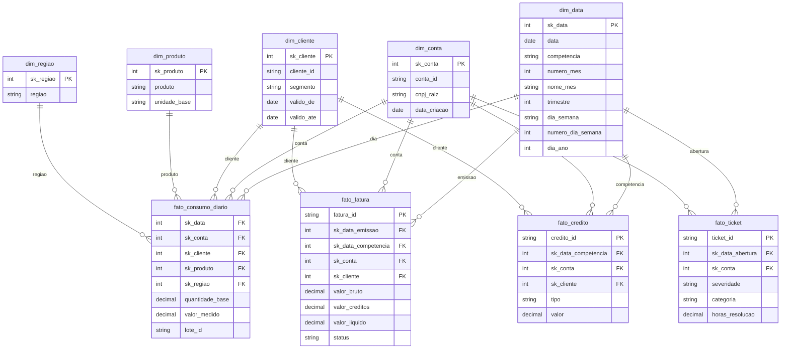

# NuvemBR — Case técnico: Analista de Dados Sênior

## Objetivo

A NuvemBR é uma provedora fictícia de nuvem pública (computação, armazenamento, banco de dados e Kubernetes cobrados por consumo, em reais). A diretoria pediu uma **visão única e confiável de faturamento**: saber se a empresa cresce de forma saudável e onde está perdendo receita, já que cada área trazia um número diferente.

Este projeto:

1. investiga a qualidade dos dados de três sistemas não integrados (CRM, Billing e Medição/Suporte), cobrindo jan a out/2026;
2. reconcilia consumo medido × faturado × créditos;
3. constrói um modelo dimensional (star schema) e uma camada de consumo em SQL para alimentar o painel da diretoria.

## Ferramentas e bibliotecas

| Ferramenta | Para que serve |
|---|---|
| **Google Sheets + Gemini** | Análise exploratória inicial, aproveitando o baixo volume de registros. |
| **DuckDB** | Engine analítica local: lê os CSVs direto (`read_csv_auto`), valida os erros com SQL e faz as transformações. |
| **PostgreSQL 16** | Banco onde o star schema é carregado e consumido pelas views e pelo BI. |
| **Docker Compose** | Sobe o Postgres local e executa o DDL de referência (`sql/00_ddl_postgres.sql`). |
| **SQLAlchemy** | Define o modelo (`src/nuvem_br/models.py`), cria as tabelas e faz a carga no Postgres. |
| **psycopg** | Driver de conexão do Python com o Postgres. |
| **uv** | Gerência de dependências e ambiente virtual (`uv run main.py`). |
| **Black** | Formatação do código Python (grupo `dev`). |
| **Claude (Copilot)** | Apoio na modelagem, na implementação e na revisão. Ver o log de uso de IA. |

## Como o estudo foi feito

### 1. Análise inicial no Google Sheets com Gemini

O estudo começou numa planilha no Google Sheets integrada ao Gemini. Como o volume de registros das bases de cadastro, faturas, créditos e tickets é pequeno, a ferramenta lida bem com eles, e isso permitiu levantar rapidamente hipóteses de erros e inconsistências.

Planilha: [Google Sheets do estudo inicial](https://docs.google.com/spreadsheets/d/1Zea6SxyMECFV3Hx8vx-2CQkjlMCYN25a8ka0u1HzCzw/edit?gid=89575018#gid=89575018)

### 2. Validação com consultas em DuckDB

Antes de criar o star schema, o que foi observado no Google Sheets foi validado com consultas em DuckDB, na pasta [exploracao_erro_bases](exploracao_erro_bases/). Cada arquivo é um estudo com células `# %%` que explora uma base (ou o cruzamento entre bases), mostra a evidência por query e documenta o erro encontrado:

- `estudo_base_billing_contas.py`: contas sem cliente, CNPJ raiz com máscara.
- `estudo_base_crm_historico.py`: consistência do histórico de segmento do CRM.
- `estudo_base_faturas_credito.py`: faturas × créditos.
- `estudo_base_faturas_consumo_diario.py`: faturado × consumo medido.
- `estudo_base_consumo_ticket.py`: créditos de SLA × tickets de indisponibilidade.

### 3. Relatório de anomalias

Com os problemas confirmados, foi elaborado o relatório de anomalias (problema, evidência, impacto em R$, tratamento aplicado e time responsável pela correção). Ele está em PDF na pasta [relatorio_anomalias](relatorio_anomalias/).

### 4. Modelagem dimensional e pipeline

Entendidos os problemas e já familiarizado com os dados, o star schema foi desenhado em conjunto com o Claude. A proposta inicial foi usar o DuckDB para transformar os dados, pois já fazia parte da stack, e o SQLAlchemy como engine para alimentar o Postgres com os dados já validados.

Fluxo do pipeline (`main.py`):

```
CSVs (data/) -> DuckDB (limpeza e transformação) -> Postgres (schema dw, via SQLAlchemy)
             -> views da camada de consumo (sql/camada_consumo) -> validações
```

## Star Schema — NuvemBR

Modelo dimensional com quatro tabelas fato (consumo, fatura, crédito, ticket) ligadas às dimensões data, conta, cliente, produto e região.



## Como executar

```bash
docker compose up -d      # sobe o Postgres
uv sync                   # instala as dependências
uv run main.py            # transforma, carrega, aplica as views e valida
```

O código de saída é `1` se alguma validação falhar, o que permite agendar a execução em cron ou Airflow.

## Estrutura do repositório

```text
nuvem_br/
├── data/                           # Arquivos CSV brutos fornecidos
├── exploracao_bases/               # Estudos exploratórios das bases válidas
├── exploracao_erro_bases/          # Investigação de inconsistências e problemas
├── nuvem_br/                       # Código Python do pipeline
│   ├── config.py                   # Configuração de caminhos e conexão DuckDB
│   ├── load.py                     # Criação das tabelas e aplicação da camada de consumo
│   ├── models.py                   # DDL e criação das tabelas
│   ├── transform.py                # Limpeza, padronização e transformação dos CSVs
│   └── validate.py                 # Validações e testes de qualidade
├── sql/
│   ├── 00_ddl_postgres.sql         # DDL de referência
│   └── 01_consumo.sql              # Modelo dimensional e métricas de consumo
├── outputs/                        # Arquivos gerados pelas análises
├── main.py                         # Orquestração completa do pipeline
├── pyproject.toml                  # Dependências e configuração do projeto
├── uv.lock                         # Lock das dependências
└── README.md                       # Documentação do projeto
