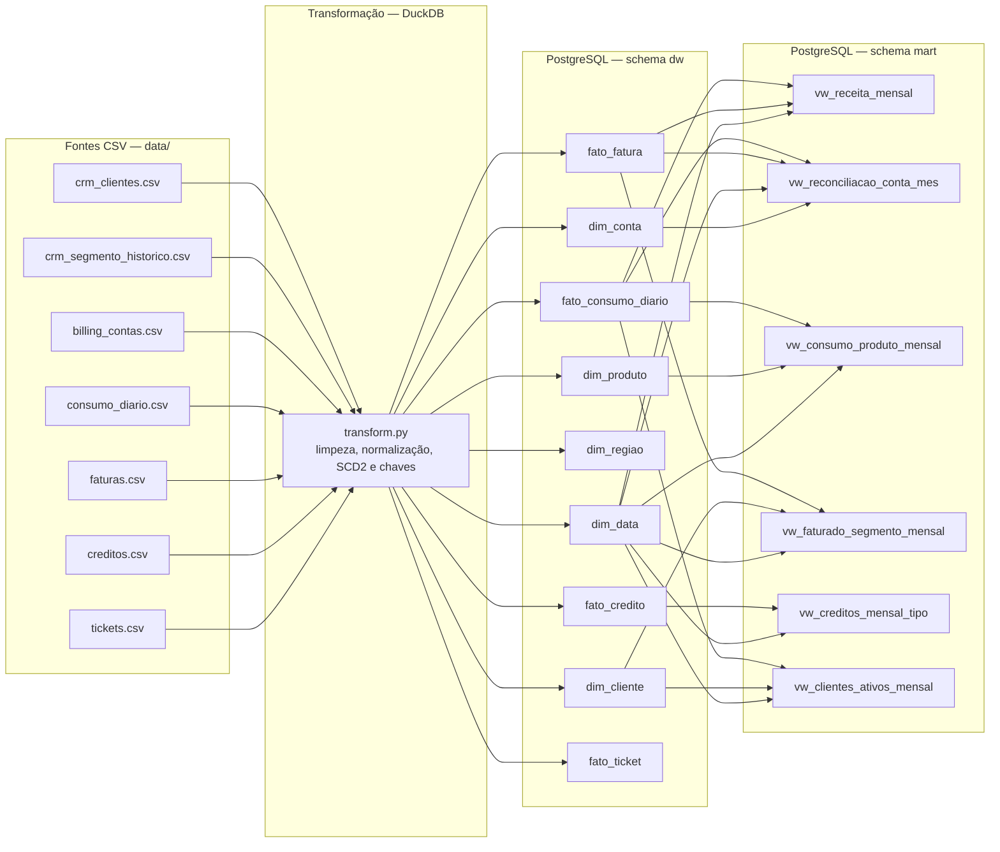

# Dicionário de dados e linhagem — NuvemBR

> **Objetivo:** documentar as bases CSV, as tabelas do Data Warehouse (`dw`) e as views da camada gerencial (`mart`).
>
> **Período das fontes:** janeiro a outubro de 2026.  
> **Formato das fontes:** CSV, com cabeçalho e delimitador vírgula.  
> **Pipeline:** `data/*.csv` → DuckDB (`transform.py`) → PostgreSQL (`dw`) → views gerenciais (`mart`).

## 1. Convenções

- **PK:** chave primária.
- **FK:** chave estrangeira.
- **SK:** *surrogate key*, chave técnica gerada pelo pipeline.
- **SCD2:** histórico de alterações preservado em versões com `valido_de` e `valido_ate`.
- **Grão:** nível de detalhe que identifica uma linha.
- Tipos dos CSVs são descritos a partir do padrão esperado pela origem. O `read_csv_auto` do DuckDB faz a inferência técnica durante a carga.
- Valores monetários estão em **reais (R$)**, salvo indicação contrária.
- As tabelas de fatos podem receber o membro `sk_cliente = -1` (`Não vinculado`) quando o cliente não puder ser identificado no período do evento.
- A carga do DW é um **full refresh**: as tabelas são esvaziadas e carregadas novamente em uma única transação.

---

## 2. Inventário das fontes CSV

| Arquivo | Sistema | Grão | Linhas | Uso principal |
|---|---|---|---:|---|
| `crm_clientes.csv` | CRM | 1 cliente | 90 | Cadastro atual do cliente |
| `crm_segmento_historico.csv` | CRM | 1 cliente × período de segmento | 98 | Histórico SCD2 do segmento |
| `billing_contas.csv` | Billing | 1 conta de cobrança | 93 | Relacionar contas, clientes e CNPJ |
| `consumo_diario.csv` | Medição | Dia × conta × produto × região × lote | 91.396 | Consumo e receita medida |
| `faturas.csv` | Billing | 1 fatura emitida | 785 | Receita faturada |
| `creditos.csv` | Billing | 1 crédito | 80 | Descontos e compensações |
| `tickets.csv` | Suporte | 1 chamado | 371 | Atendimento e validação de SLA |

### 2.1 `crm_clientes.csv`

**Descrição:** cadastro atual dos clientes no CRM.  
**Formato:** CSV UTF-8, cabeçalho na primeira linha, separador `,`.  
**Grão:** uma linha por `cliente_id`.  
**Destino no DW:** `dw.dim_cliente` e, indiretamente, resolução dos relacionamentos entre contas e clientes.

| Campo | Tipo esperado na origem | Nulo? | Descrição | Problemas conhecidos / tratamento |
|---|---|---:|---|---|
| `cliente_id` | Texto (`varchar(10)`) | Não | Identificador natural único do cliente. | Nenhum; usado para relacionamentos. |
| `razao_social` | Texto (`varchar(120)`) | Sim | Razão social do cliente. | Existem razões sociais repetidas com CNPJs diferentes; não deve ser usada como chave. |
| `cnpj_raiz` | Texto de 8 dígitos (`varchar(12)`) | Sim | CNPJ raiz usado no vínculo com Billing. | Sem duplicidade; no pipeline apenas dígitos são mantidos. |
| `segmento` | Texto (`varchar(20)`) | Sim | Segmento atual: SMB, Mid ou Enterprise. | Não utilizado diretamente nos fatos; o histórico é a fonte para análises temporais. |
| `canal` | Texto (`varchar(20)`) | Sim | Canal comercial atual. | Tratado como atributo tipo 1, repetido em todas as versões da dimensão. |
| `uf` | Texto (`char(2)`) | Sim | Unidade federativa. | Tratado como atributo tipo 1. |
| `data_inicio` | Data (`YYYY-MM-DD`) | Sim | Data de início do cliente. | Coerente com a primeira vigência de segmento. |

**Controles verificados:** `cnpj_raiz` sem duplicidade; todos os clientes do histórico existem nesta base.

### 2.2 `crm_segmento_historico.csv`

**Descrição:** histórico de vigência do segmento comercial dos clientes.  
**Formato:** CSV UTF-8 com cabeçalho.  
**Grão:** uma linha por `cliente_id` e `valido_de`.  
**Destino no DW:** `dw.dim_cliente` (SCD tipo 2 no segmento).

| Campo | Tipo esperado na origem | Nulo? | Descrição | Problemas conhecidos / tratamento |
|---|---|---:|---|---|
| `cliente_id` | Texto (`varchar(10)`) | Não | Identificador do cliente. | Todos os valores existem em `crm_clientes.csv`. |
| `segmento` | Texto (`varchar(20)`) | Sim | Segmento válido no período. | Preservado historicamente. |
| `valido_de` | Data (`YYYY-MM-DD`) | Não | Início da vigência, inclusive. | O menor valor por cliente coincide com `data_inicio`. |
| `valido_ate` | Data (`YYYY-MM-DD`) | Sim | Fim da vigência, inclusive; vazio significa vigente. | O pipeline converte nulo em `9999-12-31`. |

**Controles verificados:** o segmento mais recente coincide com o segmento atual do CRM.

### 2.3 `billing_contas.csv`

**Descrição:** cadastro das contas de faturamento e vínculo com o CRM.  
**Formato:** CSV UTF-8 com cabeçalho.  
**Grão:** uma linha por `conta_id`.  
**Destino no DW:** `dw.dim_conta` e resolução de `sk_cliente` nos fatos.

| Campo | Tipo esperado na origem | Nulo? | Descrição | Problemas conhecidos / tratamento |
|---|---|---:|---|---|
| `conta_id` | Texto (`varchar(10)`) | Não | Identificador único da conta de faturamento. | Nenhum conhecido. |
| `cliente_id` | Texto (`varchar(10)`) | Sim | Vínculo manual da conta com o cliente do CRM. | 6 das 93 contas estão sem cliente; recuperadas pelo CNPJ. Nenhum `cliente_id` preenchido foi considerado incorreto. |
| `cnpj_raiz` | Texto (`varchar(12)`) | Sim | CNPJ raiz associado à conta. | 2 valores possuem máscara, por exemplo `75.742.256`; o pipeline remove caracteres não numéricos e exige 8 dígitos. |
| `data_criacao` | Data (`YYYY-MM-DD`) | Sim | Data de criação da conta. | Sem tratamento corretivo conhecido. |

### 2.4 `consumo_diario.csv`

**Descrição:** dados de medição diária dos produtos de nuvem, incluindo o lote de carga.  
**Formato:** CSV UTF-8 com cabeçalho; `carregado_em` usa data e hora.  
**Grão bruto:** dia × conta × produto × região × lote.  
**Grão no DW:** dia × conta × produto × região, após deduplicação.  
**Destino no DW:** `dw.fato_consumo_diario`, `dw.dim_produto`, `dw.dim_regiao` e participação em `dw.dim_data`.

| Campo | Tipo esperado na origem | Nulo? | Descrição | Problemas conhecidos / tratamento |
|---|---|---:|---|---|
| `data` | Data (`YYYY-MM-DD`) | Não | Dia de referência do consumo. | Convertida em `sk_data = AAAAMMDD`. |
| `conta_id` | Texto (`varchar(10)`) | Não | Conta que consumiu o produto. | Relacionada à `dim_conta`. |
| `produto` | Texto (`varchar(20)`) | Não | Produto consumido, como VM_COMPUTE ou OBJECT_STORAGE. | Alimenta `dim_produto`. |
| `regiao` | Texto (`varchar(20)`) | Não | Região do recurso. | Alimenta `dim_regiao`. |
| `quantidade` | Decimal (`numeric(18,4)`) | Não | Quantidade consumida na unidade informada. | Valores em `TB-dia` são multiplicados por 1.024. |
| `unidade` | Texto (`varchar(20)`) | Não | Unidade da quantidade, como GB-dia ou vCPU-hora. | OBJECT_STORAGE chega também como `TB-dia`; unidade-base final é `GB-dia`. |
| `preco_unitario` | Decimal (`numeric(12,6)`) | Não | Preço por unidade-base. | Usado para calcular `valor_medido = quantidade_base × preco_unitario`. |
| `lote_id` | Texto (`varchar(20)`) | Não | Identificador do lote diário. | Mantido no fato para auditoria. |
| `carregado_em` | Timestamp | Não | Data e hora em que o lote foi carregado. | 298 linhas duplicadas por recarga; mantém-se a carga mais recente, usando `lote_id` como desempate. |

### 2.5 `faturas.csv`

**Descrição:** faturas emitidas pelo Billing, incluindo canceladas e substitutas.  
**Formato:** CSV UTF-8 com cabeçalho.  
**Grão:** uma linha por `fatura_id`.  
**Destino no DW:** `dw.fato_fatura` e participação em `dw.dim_data`.

| Campo | Tipo esperado na origem | Nulo? | Descrição | Problemas conhecidos / tratamento |
|---|---|---:|---|---|
| `fatura_id` | Texto (`varchar(12)`) | Não | Identificador da fatura. | Sem duplicidade entre faturas não canceladas. |
| `conta_id` | Texto (`varchar(10)`) | Não | Conta faturada. | Relacionada à `dim_conta`. |
| `competencia` | Texto (`YYYY-MM`) | Não | Mês ao qual a fatura se refere. | Convertida para o primeiro dia do mês e associada à `dim_data`. |
| `valor_bruto` | Decimal (`numeric(14,2)`) | Sim | Valor faturado antes dos créditos. | Usado como base de receita bruta, excluindo status `CANCELADA`. |
| `valor_creditos` | Decimal (`numeric(14,2)`) | Sim | Créditos informados na própria fatura. | Uma divergência identificada com a tabela de créditos: conta `B-00082`, competência `2026-01`. |
| `valor_liquido` | Decimal (`numeric(14,2)`) | Sim | Valor líquido informado pelo Billing. | Há registros onde veio como bruto + créditos; o DW recalcula e preserva o valor original em `valor_liquido_origem`. |
| `status` | Texto (`varchar(12)`) | Não | PAGA, ABERTA, VENCIDA ou CANCELADA. | Todas as linhas entram no DW; análises de receita filtram `status <> 'CANCELADA'`. |
| `data_emissao` | Data (`YYYY-MM-DD`) | Não | Data de emissão. | Define a versão SCD2 do cliente no fato. |
| `fatura_substituta_id` | Texto (`varchar(12)`) | Sim | Fatura que substitui a atual, quando aplicável. | Mantida para auditoria; evita contar canceladas e substitutas em duplicidade. |

### 2.6 `creditos.csv`

**Descrição:** créditos concedidos aos clientes.  
**Formato:** CSV UTF-8 com cabeçalho.  
**Grão:** uma linha por `credito_id`.  
**Destino no DW:** `dw.fato_credito` e participação em `dw.dim_data`.

| Campo | Tipo esperado na origem | Nulo? | Descrição | Problemas conhecidos / tratamento |
|---|---|---:|---|---|
| `credito_id` | Texto (`varchar(10)`) | Não | Identificador do crédito. | Chave natural/primária. |
| `conta_id` | Texto (`varchar(10)`) | Não | Conta beneficiada. | Relacionada à `dim_conta`. |
| `competencia` | Texto (`YYYY-MM`) | Não | Competência do crédito. | Convertida para a data-chave do primeiro dia do mês. |
| `tipo` | Texto (`varchar(15)`) | Não | PROMOCIONAL, SLA ou COMERCIAL. | SLA deve, por regra de negócio, possuir evidência em ticket. |
| `valor` | Decimal (`numeric(14,2)`) | Não | Valor concedido. | Total esperado: R$ 105.190,83. |
| `descricao` | Texto (`varchar(120)`) | Sim | Justificativa ou descrição do crédito. | Não é carregada no DW atual. |

**Anomalia conhecida:** dos 14 créditos SLA, 7 não possuem ticket de indisponibilidade na mesma conta (`CR-00060`, `CR-00061`, `CR-00062`, `CR-00063`, `CR-00064`, `CR-00065` e `CR-00067`).

### 2.7 `tickets.csv`

**Descrição:** chamados exportados pela plataforma de suporte.  
**Formato:** CSV UTF-8 com cabeçalho.  
**Grão:** uma linha por `ticket_id`.  
**Destino no DW:** `dw.fato_ticket` e participação em `dw.dim_data`.

| Campo | Tipo esperado na origem | Nulo? | Descrição | Problemas conhecidos / tratamento |
|---|---|---:|---|---|
| `ticket_id` | Texto (`varchar(10)`) | Não | Identificador do chamado. | Chave natural/primária. |
| `conta_id` | Texto (`varchar(10)`) | Não | Conta associada ao chamado. | Relacionada à `dim_conta`. |
| `aberto_em` | Timestamp textual ISO 8601 | Não | Data/hora de abertura; exemplo com sufixo `Z`. | Convertida assumindo UTC. |
| `resolvido_em` | Timestamp textual | Sim | Data/hora de resolução, sem sufixo de fuso. | Assumido UTC; nulo gera `horas_resolucao` nula. |
| `severidade` | Texto (`char(2)`) | Não | Severidade S1, S2 ou S3. | Sem correção conhecida. |
| `categoria` | Texto (`varchar(30)`) | Não | Categoria do chamado. | Usada para verificar evidência de créditos SLA, especialmente `Indisponibilidade`. |

---

## 3. Regras de transformação

As regras são executadas em `src/nuvem_br/transform.py` antes da carga no PostgreSQL.

| Regra | Entrada | Tratamento | Destino |
|---|---|---|---|
| Deduplicação de lote | `consumo_diario.csv` | Mantém o maior `carregado_em` por dia, conta, produto e região; `lote_id` desempata. | `fato_consumo_diario` |
| Conversão de unidade | `consumo_diario.csv` | `TB-dia` vira `GB-dia`, multiplicando a quantidade por 1.024. | `quantidade_base`, `dim_produto.unidade_base` |
| Valor medido | `quantidade`, `preco_unitario` | `quantidade_base × preco_unitario`, arredondado para 4 casas. | `fato_consumo_diario.valor_medido` |
| Faturas canceladas | `faturas.csv` | Mantidas no fato; a receita as exclui nas views. | `fato_fatura.status` |
| Valor líquido | `faturas.csv` | Recalcula `valor_bruto - valor_creditos`; preserva o original. | `valor_liquido`, `valor_liquido_origem` |
| CNPJ raiz | CRM e Billing | Remove pontuação e conserva apenas 8 dígitos. | `dim_conta.cnpj_raiz` |
| Cliente ausente | `billing_contas.csv` | Se `cliente_id` estiver vazio, recupera pelo CNPJ normalizado. | `sk_cliente` dos fatos |
| Cliente não vinculado | Falha na resolução/ vigência | Usa `sk_cliente = -1`. | `fato_consumo_diario`, `fato_fatura`, `fato_credito` |
| SCD2 | CRM histórico | Escolhe a versão válida na data do evento. | `fato_consumo_diario`, `fato_fatura`, `fato_credito` |
| Tempo de resolução | `tickets.csv` | Diferença entre resolução e abertura, em horas. | `fato_ticket.horas_resolucao` |

---

## 4. Dicionário do Data Warehouse

O DW está no schema `dw` do PostgreSQL e foi modelado em `src/nuvem_br/models.py`.

### 4.1 `dw.dim_data`

**Tipo:** dimensão conformada.  
**Grão:** uma linha por dia.  
**Origens:** datas encontradas em todos os CSVs.  
**PK:** `sk_data`.

| Campo | Tipo PostgreSQL | Nulo? | Chave/regra | Descrição |
|---|---|---:|---|---|
| `sk_data` | `integer` | Não | PK | Data codificada como `AAAAMMDD`. |
| `data` | `date` | Não | Único | Data do calendário. |
| `competencia` | `varchar(7)` | Não | — | Ano e mês no formato `YYYY-MM`. |
| `numero_mes` | `integer` | Não | 1 a 12 | Número do mês. |
| `nome_mes` | `varchar(10)` | Não | — | Nome do mês em português. |
| `trimestre` | `integer` | Não | 1 a 4 | Trimestre do ano. |
| `dia_semana` | `varchar(15)` | Não | — | Nome do dia da semana. |
| `numero_dia_semana` | `integer` | Não | 1 a 7 | Dia ISO, onde 1 é segunda-feira. |
| `dia_ano` | `integer` | Não | 1 a 366 | Número do dia no ano. |

### 4.2 `dw.dim_conta`

**Tipo:** dimensão.  
**Grão:** uma linha por conta.  
**Origem:** `billing_contas.csv`, com tratamento de CNPJ.  
**PK:** `sk_conta`.

| Campo | Tipo PostgreSQL | Nulo? | Chave/regra | Descrição |
|---|---|---:|---|---|
| `sk_conta` | `integer` | Não | PK | Chave técnica determinística. |
| `conta_id` | `varchar(10)` | Não | Único | Identificador natural da conta. |
| `cnpj_raiz` | `varchar(8)` | Não | Normalizado | CNPJ raiz contendo somente 8 dígitos. |
| `data_criacao` | `date` | Não | — | Data de criação da conta. |

### 4.3 `dw.dim_cliente`

**Tipo:** dimensão SCD2.  
**Grão:** uma linha por cliente e período de vigência do segmento.  
**Origens:** `crm_segmento_historico.csv` + atributos atuais de `crm_clientes.csv`.  
**PK:** `sk_cliente`.  
**Regra única:** (`cliente_id`, `valido_de`).

| Campo | Tipo PostgreSQL | Nulo? | Chave/regra | Descrição |
|---|---|---:|---|---|
| `sk_cliente` | `integer` | Não | PK | Versão técnica do cliente; `-1` representa não vinculado. |
| `cliente_id` | `varchar(10)` | Não | Natural | Identificador do cliente. |
| `segmento` | `varchar(20)` | Sim | SCD2 | Segmento válido no período. |
| `canal` | `varchar(20)` | Sim | Tipo 1 | Canal atual, repetido nas versões. |
| `uf` | `char(2)` | Sim | Tipo 1 | UF atual, repetida nas versões. |
| `valido_de` | `date` | Não | SCD2 | Início da vigência. |
| `valido_ate` | `date` | Não | SCD2 | Fim inclusivo; `9999-12-31` representa vigente. |

### 4.4 `dw.dim_produto`

**Tipo:** dimensão.  
**Grão:** uma linha por produto.  
**Origem:** `consumo_diario.csv`.  
**PK:** `sk_produto`.

| Campo | Tipo PostgreSQL | Nulo? | Chave/regra | Descrição |
|---|---|---:|---|---|
| `sk_produto` | `integer` | Não | PK | Chave técnica do produto. |
| `produto` | `varchar(20)` | Não | Único | Nome do produto. |
| `unidade_base` | `varchar(20)` | Não | Normalizado | Unidade oficial; `TB-dia` é padronizado como `GB-dia`. |

### 4.5 `dw.dim_regiao`

**Tipo:** dimensão.  
**Grão:** uma linha por região.  
**Origem:** `consumo_diario.csv`.  
**PK:** `sk_regiao`.

| Campo | Tipo PostgreSQL | Nulo? | Chave/regra | Descrição |
|---|---|---:|---|---|
| `sk_regiao` | `integer` | Não | PK | Chave técnica da região. |
| `regiao` | `varchar(20)` | Não | Único | Região do consumo. |

### 4.6 `dw.fato_consumo_diario`

**Tipo:** fato aditivo.  
**Grão:** dia × conta × produto × região.  
**Origem:** `consumo_diario.csv`, após deduplicação e conversão de unidade.  
**PK:** (`sk_data`, `sk_conta`, `sk_produto`, `sk_regiao`).

| Campo | Tipo PostgreSQL | Nulo? | Chave/regra | Descrição / origem |
|---|---|---:|---|---|
| `sk_data` | `integer` | Não | PK/FK `dim_data` | Data do consumo. |
| `sk_conta` | `integer` | Não | PK/FK `dim_conta` | Conta consumidora. |
| `sk_produto` | `integer` | Não | PK/FK `dim_produto` | Produto consumido. |
| `sk_regiao` | `integer` | Não | PK/FK `dim_regiao` | Região do consumo. |
| `sk_cliente` | `integer` | Não | FK `dim_cliente` | Versão do cliente válida na data do consumo. |
| `quantidade_base` | `numeric(18,4)` | Não | Aditiva | Quantidade convertida para a unidade-base. |
| `valor_medido` | `numeric(18,4)` | Não | Aditiva | `quantidade_base × preco_unitario`. |
| `lote_id` | `varchar(20)` | Não | Auditoria | Lote vencedor após a deduplicação. |

### 4.7 `dw.fato_fatura`

**Tipo:** fato de transação.  
**Grão:** uma fatura emitida.  
**Origem:** `faturas.csv`.  
**PK:** `fatura_id`.

| Campo | Tipo PostgreSQL | Nulo? | Chave/regra | Descrição / origem |
|---|---|---:|---|---|
| `fatura_id` | `varchar(20)` | Não | PK | Identificador da fatura. |
| `sk_data_emissao` | `integer` | Não | FK `dim_data` | Data de emissão. |
| `sk_data_competencia` | `integer` | Não | FK `dim_data` | Primeiro dia da competência. |
| `sk_conta` | `integer` | Não | FK `dim_conta` | Conta faturada. |
| `sk_cliente` | `integer` | Não | FK `dim_cliente` | Cliente SCD2 válido na emissão. |
| `valor_bruto` | `numeric(18,4)` | Não | Aditiva | Valor antes dos créditos. |
| `valor_creditos` | `numeric(18,4)` | Não | Aditiva | Créditos informados na fatura. |
| `valor_liquido` | `numeric(18,4)` | Não | Recalculada | `valor_bruto - valor_creditos`. |
| `valor_liquido_origem` | `numeric(18,4)` | Não | Auditoria | Valor líquido exatamente como veio do Billing. |
| `status` | `varchar(20)` | Não | Filtro | Status da fatura. Receita exige `<> 'CANCELADA'`. |
| `fatura_substituta_id` | `varchar(20)` | Sim | Auditoria | Identificador da fatura substituta. |

### 4.8 `dw.fato_credito`

**Tipo:** fato de transação.  
**Grão:** um crédito concedido.  
**Origem:** `creditos.csv`.  
**PK:** `credito_id`.

| Campo | Tipo PostgreSQL | Nulo? | Chave/regra | Descrição / origem |
|---|---|---:|---|---|
| `credito_id` | `varchar(20)` | Não | PK | Identificador do crédito. |
| `sk_data_competencia` | `integer` | Não | FK `dim_data` | Primeiro dia da competência. |
| `sk_conta` | `integer` | Não | FK `dim_conta` | Conta que recebeu o crédito. |
| `sk_cliente` | `integer` | Não | FK `dim_cliente` | Versão válida no último dia da competência. |
| `tipo` | `varchar(20)` | Não | — | PROMOCIONAL, SLA ou COMERCIAL. |
| `valor` | `numeric(18,4)` | Não | Aditiva | Valor do crédito. |

> `descricao` existe no CSV, mas não foi carregada no modelo atual do DW.

### 4.9 `dw.fato_ticket`

**Tipo:** fato de transação.  
**Grão:** um chamado de suporte.  
**Origem:** `tickets.csv`.  
**PK:** `ticket_id`.

| Campo | Tipo PostgreSQL | Nulo? | Chave/regra | Descrição / origem |
|---|---|---:|---|---|
| `ticket_id` | `varchar(20)` | Não | PK | Identificador do chamado. |
| `sk_data_abertura` | `integer` | Não | FK `dim_data` | Data de abertura. |
| `sk_conta` | `integer` | Não | FK `dim_conta` | Conta associada. |
| `severidade` | `varchar(10)` | Não | — | Severidade do chamado. |
| `categoria` | `varchar(30)` | Não | — | Categoria do atendimento. |
| `horas_resolucao` | `numeric(18,4)` | Sim | Derivada | Horas entre abertura e resolução, assumindo UTC. |

---

## 5. Views da camada gerencial

As views ficam no schema `mart` e são criadas pelo script `sql/camada_consumo/01_views_diretoria.sql`.

### 5.1 `mart.vw_receita_mensal`

**Uso:** visão única da diretoria para crescimento e perda de receita.

| Campo | Descrição | Definição |
|---|---|---|
| `competencia` | Mês de análise | `dim_data.competencia`. |
| `consumo_medido` | Receita potencial medida | Soma de `fato_consumo_diario.valor_medido`. |
| `faturado_bruto` | Receita bruta faturada | Soma de faturas ativas (`status <> 'CANCELADA'`). |
| `creditos` | Créditos informados nas faturas | Soma de `fato_fatura.valor_creditos`. |
| `faturado_liquido` | Receita líquida faturada | Bruto menos créditos, usando `valor_liquido` recalculado. |
| `receita_nao_faturada` | Consumo ainda não faturado | `consumo_medido - faturado_bruto`. |
| `pct_nao_faturado` | Percentual não faturado | `receita_nao_faturada / consumo_medido × 100`. |
| `pct_creditos` | Peso dos créditos | `creditos / faturado_bruto × 100`. |
| `crescimento_liquido_mom_pct` | Crescimento mensal líquido | Variação de `faturado_liquido` contra o mês anterior. |

### 5.2 `mart.vw_reconciliacao_conta_mes`

**Uso:** identificar contas com diferença entre consumo medido e faturamento.

| Campo | Descrição |
|---|---|
| `conta_id` | Conta reconciliada. |
| `competencia` | Mês da reconciliação. |
| `valor_medido` | Soma do consumo medido. |
| `valor_faturado` | Soma das faturas ativas. |
| `diferenca` | `valor_faturado - valor_medido`. |
| `diferenca_pct` | Percentual da diferença sobre o medido. |
| `divergente` | Verdadeiro quando a diferença absoluta excede 0,5% do medido. |

### 5.3 `mart.vw_consumo_produto_mensal`

**Uso:** composição e crescimento por produto.

| Campo | Descrição |
|---|---|
| `competencia` | Mês do consumo. |
| `produto` | Produto consumido. |
| `valor_medido` | Soma do consumo medido do produto. |
| `participacao_pct` | Participação do produto no mês. |
| `crescimento_mom_pct` | Crescimento do produto contra o mês anterior. |

### 5.4 `mart.vw_faturado_segmento_mensal`

**Uso:** faturamento por segmento comercial com histórico preservado.

| Campo | Descrição |
|---|---|
| `competencia` | Competência da fatura. |
| `segmento` | Segmento SCD2 válido na emissão. |
| `clientes_faturados` | Clientes distintos faturados. |
| `faturado_bruto` | Soma do bruto das faturas ativas. |
| `creditos` | Soma dos créditos informados nas faturas. |
| `faturado_liquido` | Soma do líquido recalculado. |

### 5.5 `mart.vw_creditos_mensal_tipo`

**Uso:** acompanhar créditos promocionais, SLA e comerciais.

| Campo | Descrição |
|---|---|
| `competencia` | Competência do crédito. |
| `tipo` | PROMOCIONAL, SLA ou COMERCIAL. |
| `quantidade` | Número de créditos. |
| `valor` | Soma dos valores dos créditos. |

### 5.6 `mart.vw_clientes_ativos_mensal`

**Uso:** acompanhar clientes ativos, novos e perdidos.

| Campo | Descrição |
|---|---|
| `competencia` | Mês observado. |
| `clientes_ativos` | Clientes com `valor_medido > 0` no mês. |
| `clientes_novos` | Clientes cuja primeira competência de consumo é o mês atual. |
| `clientes_perdidos` | Clientes ativos no mês anterior e sem consumo no atual. |

> **Atenção:** a série inicia em janeiro de 2026, portanto todos os clientes existentes em janeiro podem ser classificados como novos nesse mês. A interpretação de novos deve começar preferencialmente em fevereiro.

---

## 6. Linhagem ponta a ponta

### 6.1 Visão geral

### 6.2 Linhagem detalhada por destino

| Fonte | Transformação principal | Tabela DW | Views gerenciais consumidoras |
|---|---|---|---|
| `crm_clientes.csv` | Atributos atuais; CNPJ normalizado | `dim_cliente`, apoio a `dim_conta` | `vw_faturado_segmento_mensal`, `vw_clientes_ativos_mensal` |
| `crm_segmento_historico.csv` | SCD2; fim nulo vira `9999-12-31` | `dim_cliente` | `vw_faturado_segmento_mensal`, `vw_clientes_ativos_mensal` |
| `billing_contas.csv` | Normaliza CNPJ e recupera cliente ausente | `dim_conta` | `vw_reconciliacao_conta_mes` |
| `consumo_diario.csv` | Deduplica lotes; converte unidade; calcula valor medido | `fato_consumo_diario`, `dim_produto`, `dim_regiao`, `dim_data` | `vw_receita_mensal`, `vw_reconciliacao_conta_mes`, `vw_consumo_produto_mensal`, `vw_clientes_ativos_mensal` |
| `faturas.csv` | Recalcula líquido; preserva canceladas | `fato_fatura`, `dim_data` | `vw_receita_mensal`, `vw_reconciliacao_conta_mes`, `vw_faturado_segmento_mensal` |
| `creditos.csv` | Seleciona cliente válido no fim do mês | `fato_credito`, `dim_data` | `vw_creditos_mensal_tipo` |
| `tickets.csv` | Converte UTC e calcula horas de resolução | `fato_ticket`, `dim_data` | Sem view gerencial exclusiva no modelo atual; usado em análises de qualidade de SLA |

### 6.3 Linhagem por view gerencial

| View | Tabelas DW diretamente consumidas |
|---|---|
| `vw_receita_mensal` | `fato_consumo_diario`, `fato_fatura`, `dim_data` |
| `vw_reconciliacao_conta_mes` | `fato_consumo_diario`, `fato_fatura`, `dim_conta`, `dim_data` |
| `vw_consumo_produto_mensal` | `fato_consumo_diario`, `dim_produto`, `dim_data` |
| `vw_faturado_segmento_mensal` | `fato_fatura`, `dim_cliente`, `dim_data` |
| `vw_creditos_mensal_tipo` | `fato_credito`, `dim_data` |
| `vw_clientes_ativos_mensal` | `fato_consumo_diario`, `dim_cliente`, `dim_data` |

---

## 7. Qualidade e limitações documentadas

| Tema | Situação | Tratamento no pipeline |
|---|---|---|
| Duplicidade de medição | 298 linhas excedentes associadas a recargas. | Mantém a carga mais recente. |
| Unidade de armazenamento | OBJECT_STORAGE chega em GB-dia e TB-dia. | Converte TB-dia para GB-dia com fator 1.024. |
| Conta sem cliente | 6 contas sem `cliente_id`. | Recupera pelo CNPJ raiz normalizado. |
| CNPJ com máscara | 2 contas possuem máscara. | Remove caracteres não numéricos. |
| Valor líquido da fatura | Alguns registros vieram como bruto + créditos. | Recalcula `bruto - créditos` e preserva o valor de origem. |
| Fatura cancelada | Canceladas coexistem com substitutas. | Permanecem no fato; são excluídas das métricas de receita. |
| Crédito × fatura | 1 combinação diverge (`B-00082`, `2026-01`). | Gera aviso; não recalcula automaticamente. |
| Créditos SLA sem ticket | 7 de 14 sem evidência na mesma conta. | Mantidos no DW; devem ser corrigidos/investigados na origem. |
| Reconciliação | 4 contas divergem em mais de 0,5% desde jun/2026. | Identificadas em `vw_reconciliacao_conta_mes`; soma aproximada de R$ 102.771. |
| Tickets | Não há histórico de hora com padrão único entre abertura e resolução. | Timestamps são interpretados em UTC. |
| Descrição de crédito | Campo existe na origem. | Não integrado ao DW atual. |
| Custo | Não há dados de custo. | Métricas representam receita, não margem. |

---

## 8. Responsabilidade dos componentes

| Componente | Responsabilidade |
|---|---|
| `main.py` | Orquestra criação, transformação, carga, views e validação. |
| `src/nuvem_br/transform.py` | Lê os CSVs e aplica regras de qualidade/modelagem. |
| `src/nuvem_br/models.py` | Declara tabelas, tipos, PKs, FKs e índices do DW. |
| `src/nuvem_br/load.py` | Executa a carga idempotente e aplica os scripts de consumo. |
| `src/nuvem_br/validate.py` | Valida contagens, totais, reconciliação e chaves órfãs. |
| `sql/camada_consumo/01_views_diretoria.sql` | Cria as views gerenciais do schema `mart`. |

---

## 9. Referências

- DDL de referência das fontes: [`../sql/00_ddl_postgres.sql`](../sql/00_ddl_postgres.sql)
- Modelo SQLAlchemy do DW: [`../src/nuvem_br/models.py`](../src/nuvem_br/models.py)
- Transformações: [`../src/nuvem_br/transform.py`](../src/nuvem_br/transform.py)
- Carga: [`../src/nuvem_br/load.py`](../src/nuvem_br/load.py)
- Validações: [`../src/nuvem_br/validate.py`](../src/nuvem_br/validate.py)
- Views gerenciais: [`../sql/camada_consumo/01_views_diretoria.sql`](../sql/camada_consumo/01_views_diretoria.sql)
